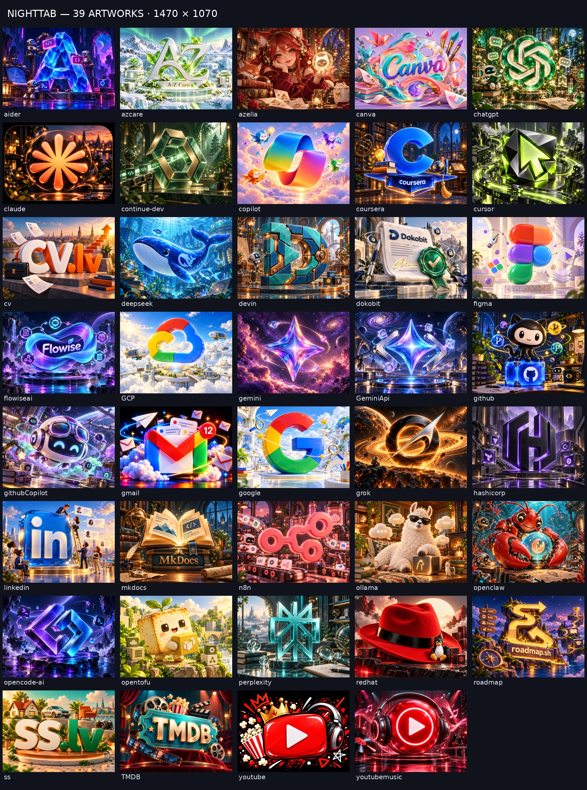

# browser-bookmarks
A creative collection of custom bookmark icons and artwork for nightTab and modern browser start pages. Featuring unique, colorful, funny, and stylish designs optimized for full-tile display. Hosted on GitHub with direct image URLs for easy integration.

## Artwork set

45 PNG images, each **1470 × 1070 pixels**. Original filenames and direct image URLs are preserved.

## New bookmarks

Six matching artworks, each **1470 × 1070 pixels**, with direct PNG links for nightTab.

| Сайт | Краткое описание | Картинка |
| --- | --- | --- |
| [Seasonvar](https://seasonvar.ru/) | Сайт для поиска и просмотра сериалов. | [seasonvar.png](https://raw.githubusercontent.com/a-zcare/browser-bookmarks/main/seasonvar.png) |
| [Google Antigravity](https://antigravity.google/) | Платформа Google для разработки приложений с ИИ-агентами. | [antigravity.png](https://raw.githubusercontent.com/a-zcare/browser-bookmarks/main/antigravity.png) |
| [Replit](https://replit.com/) | Онлайн-платформа для создания и публикации приложений с помощью ИИ. | [replit.png](https://raw.githubusercontent.com/a-zcare/browser-bookmarks/main/replit.png) |
| [Hetzner](https://www.hetzner.com/) | Облачные и выделенные серверы, веб-хостинг и хранение данных. | [hetzner.png](https://raw.githubusercontent.com/a-zcare/browser-bookmarks/main/hetzner.png) |
| [GrapheneOS](https://grapheneos.org/) | Мобильная ОС с открытым исходным кодом, ориентированная на приватность и безопасность и совместимая с Android-приложениями. | [grapheneos.png](https://raw.githubusercontent.com/a-zcare/browser-bookmarks/main/grapheneos.png) |
| [Hermes Phone](https://hermes.th3f1rm.com/) | Экосистема мобильной связи: Hermes OS, мессенджер Hermes Chat и сервис SIM/eSIM. | [hermes.png](https://raw.githubusercontent.com/a-zcare/browser-bookmarks/main/hermes.png) |

### Artwork descriptions

- **Seasonvar:** робот-киноман с оранжевой кнопкой воспроизведения, киноплёнкой и попкорном в космическом кинозале.
- **Google Antigravity:** парящая буква A с цветными гранями, робот-инженер и голограммы кода в орбитальной мастерской.
- **Replit:** оранжевые модули эмблемы, робот-разработчик и голографические приложения в мастерской.
- **Hetzner:** красная эмблема H над облачным дата-центром с маленькими роботами-техниками.
- **GrapheneOS:** графитовый смартфон, голубой защитный щит и решётка графена в технологичной лаборатории.
- **Hermes Phone:** робот-посланник в золотом крылатом шлеме, изумрудный смартфон и символы защищённой связи.

Paste a direct PNG link from the table into the tile's image URL field in nightTab. The images are original illustrative interpretations of the sites.

[Artwork prompts and reference images](artwork-prompts.md)

